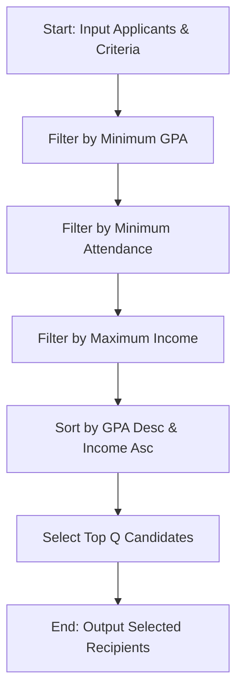

## Problem Statement

Design a multi-stage shortlisting system for a scholarship program. Given a list of applicant records, the system must filter and rank candidates through the following sequential stages:

1. **Academic Eligibility**: Retain candidates who meet or exceed a minimum GPA threshold.
2. **Attendance Requirement**: Retain candidates from the academic pool who meet or exceed a minimum attendance percentage.
3. **Income Condition**: Retain candidates whose family annual income is at or below a maximum income limit.
4. **Ranking & Quota Selection**: Sort eligible candidates primarily by GPA in descending order, and secondarily by family income in ascending order (to prioritize lower-income students in case of GPA ties). Finally, select top candidates up to a fixed scholarship quota $Q$.

---

## Algorithm

1. **Input**: Receive applicant records, minimum GPA (`min_gpa`), minimum attendance (`min_attendance`), maximum income (`max_income`), and scholarship quota (`quota`).
2. **Stage 1 (Academic Filter)**: Filter applicants where $\text{gpa} \ge \text{min\_gpa}$.
3. **Stage 2 (Attendance Filter)**: Filter Stage 1 candidates where $\text{attendance} \ge \text{min\_attendance}$.
4. **Stage 3 (Income Filter)**: Filter Stage 2 candidates where $\text{income} \le \text{max\_income}$.
5. **Ranking Stage**: Sort the fully filtered candidates by GPA descending (`-gpa`) and income ascending (`income`).
6. **Quota Selection**: Slice the sorted list to take the top `quota` candidates.
7. **Output**: Return the final selected scholarship recipients.

---

## Flowchart



---


---

## Sample Input

```json
[
  {"id": 1, "name": "Alice", "gpa": 3.8, "attendance": 85, "income": 400000},
  {"id": 2, "name": "Bob", "gpa": 3.2, "attendance": 90, "income": 300000},
  {"id": 3, "name": "Charlie", "gpa": 3.9, "attendance": 95, "income": 450000},
  {"id": 4, "name": "Diana", "gpa": 3.6, "attendance": 70, "income": 250000},
  {"id": 5, "name": "Ethan", "gpa": 3.7, "attendance": 88, "income": 600000},
  {"id": 6, "name": "Fiona", "gpa": 3.9, "attendance": 92, "income": 350000}
]

```

* **Criteria**: `min_gpa = 3.5`, `min_attendance = 80`, `max_income = 500000`, `quota = 2`

---

## Sample Output

```json
[
  {"id": 6, "name": "Fiona", "gpa": 3.9, "attendance": 92, "income": 350000},
  {"id": 3, "name": "Charlie", "gpa": 3.9, "attendance": 95, "income": 450000}
]

```
