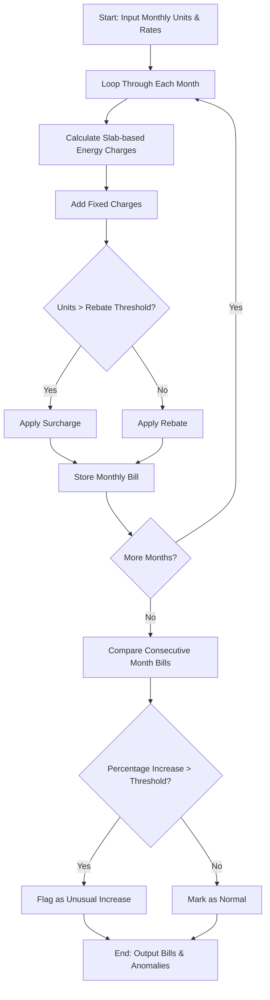

## Problem Statement

Develop an automated progressive electricity billing and consumption analysis system. The system must calculate monthly household electricity bills based on tiered consumption slabs, fixed monthly charges, high-usage surcharges, and low-usage rebates. Furthermore, the system must process historical multi-month billing records, evaluate consecutive month-over-month cost variations, and automatically flag any unusual or abnormal bill spikes that exceed a predefined percentage threshold.

---

## Algorithm

1. **Input**: Receive monthly consumption units, slab tier definitions, fixed charges, surcharge rate, rebate threshold, rebate amount, and the unusual increase percentage threshold.
2. **Bill Calculation**:
* For a given month's units, traverse the progressive slabs.
* Accumulate the cost based on units falling into each tier limit and rate.
* Add the fixed monthly charge.
* If total consumption exceeds the rebate threshold, apply a surcharge percentage; otherwise, apply a flat rebate discount.


3. **Historical Comparison**:
* Store and compute the calculated bill for each consecutive month.
* Calculate the percentage change between each month and the preceding month.
* Compare the percentage increase against the specified unusual increase threshold.


4. **Flagging Anomalies**: Mark months that exceed the threshold as containing unusual increases.
5. **Output**: Return the calculated bills, percentage changes, and anomaly alert flags.

---

## Flowchart



---

## Python Source Code

```python
def calculate_bill(units, slabs, fixed_charge, surcharge_rate, rebate_threshold, rebate_amount):
    energy_charge = 0.0
    remaining_units = units
    
    for limit, rate in slabs:
        if remaining_units <= 0:
            break
        if limit is None:
            energy_charge += remaining_units * rate
            remaining_units = 0
        else:
            slab_units = min(remaining_units, limit)
            energy_charge += slab_units * rate
            remaining_units -= slab_units
            
    total = energy_charge + fixed_charge
    if units > rebate_threshold:
        total += total * surcharge_rate
    else:
        total -= rebate_amount
        
    return max(0.0, total)

def analyze_billing(monthly_data, slabs, fixed_charge, surcharge_rate, rebate_threshold, rebate_amount, threshold_pct):
    bills = []
    for month, units in monthly_data.items():
        bill = calculate_bill(units, slabs, fixed_charge, surcharge_rate, rebate_threshold, rebate_amount)
        bills.append((month, units, round(bill, 2)))
        
    analysis = []
    for i in range(len(bills)):
        month, units, bill = bills[i]
        if i == 0:
            analysis.append({"month": month, "units": units, "bill": bill, "increase_pct": 0.0, "unusual": False})
        else:
            prev_bill = bills[i-1][2]
            pct_increase = ((bill - prev_bill) / prev_bill) * 100 if prev_bill > 0 else 0.0
            unusual = pct_increase > threshold_pct
            analysis.append({"month": month, "units": units, "bill": bill, "increase_pct": round(pct_increase, 2), "unusual": unusual})
            
    return analysis

if __name__ == "__main__":
    slabs = [(100, 3.5), (200, 5.0), (None, 7.5)]
    fixed_charge = 150.0
    surcharge_rate = 0.10
    rebate_threshold = 100
    rebate_amount = 50.0
    threshold_pct = 25.0
    
    monthly_data = {
        "January": 120,
        "February": 95,
        "March": 110,
        "April": 250,
        "May": 420,
        "June": 400
    }
    
    results = analyze_billing(monthly_data, slabs, fixed_charge, surcharge_rate, rebate_threshold, rebate_amount, threshold_pct)
    for res in results:
        print(res)

```

---

## Sample Input

```json
{
  "slabs": [
    [100, 3.5],
    [200, 5.0],
    [null, 7.5]
  ],
  "fixed_charge": 150.0,
  "surcharge_rate": 0.10,
  "rebate_threshold": 100,
  "rebate_amount": 50.0,
  "threshold_pct": 25.0,
  "monthly_data": {
    "January": 120,
    "February": 95,
    "March": 110,
    "April": 250,
    "May": 420,
    "June": 400
  }
}

```

---

## Sample Output

```json
[
  {"month": "January", "units": 120, "bill": 620.0, "increase_pct": 0.0, "unusual": false},
  {"month": "February", "units": 95, "bill": 432.5, "increase_pct": -30.24, "unusual": false},
  {"month": "March", "units": 110, "bill": 535.0, "increase_pct": 23.7, "unusual": false},
  {"month": "April", "units": 250, "bill": 1300.0, "increase_pct": 143.18, "unusual": true},
  {"month": "May", "units": 420, "bill": 2722.5, "increase_pct": 109.42, "unusual": true},
  {"month": "June", "units": 400, "bill": 2545.0, "increase_pct": -6.52, "unusual": false}
]

```
