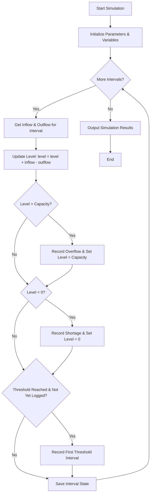

## Problem Statement

Design and implement a program to simulate the water level of a storage tank over multiple discrete time intervals (e.g., hours or days). The simulation receives the tank's maximum capacity, initial water level, a target threshold, and a sequence of inflow and outflow quantities for each interval.

For each interval, the program must:

1. Update the water level based on the current inflow and outflow.
2. Cap the water level at the maximum capacity, registering an **overflow** if the level exceeds capacity.
3. Floor the water level at zero, registering a **shortage** (deficit) if the level drops below zero.
4. Track and record the **first interval** where the water level reaches or exceeds the specified target threshold.
5. Output the status history and summary metrics for the simulation.

---

## Algorithm

1. Initialize the tank with `capacity`, `initial_level`, `threshold`, and a list of `intervals` containing `(inflow, outflow)` pairs.
2. Set `current_level = initial_level`, `first_threshold_interval = None`, and initialize logs for overflows and shortages.
3. For each interval $i$ (1-indexed):
a. Read `inflow` and `outflow` for the interval.
b. Update water level: `current_level = current_level + inflow - outflow`.
c. Check for overflow: If `current_level > capacity`, record an overflow amount of `current_level - capacity`, and set `current_level = capacity`.
d. Check for shortage: If `current_level < 0`, record a shortage amount of absolute value of `current_level`, and set `current_level = 0`.
e. Check for threshold: If `first_threshold_interval is None` and `current_level >= threshold`, set `first_threshold_interval = i`.
f. Store the ending water level for interval $i$.
4. Return the interval-by-interval water levels, recorded overflows, shortages, and the first interval the threshold was reached.

---

## Flowchart



---


---

## Sample Input

* **Tank Capacity:** $100.0$ units
* **Initial Water Level:** $40.0$ units
* **Target Threshold:** $80.0$ units
* **Interval Data (Inflow, Outflow):**
* Interval 1: Inflow = $30.0$, Outflow = $10.0$
* Interval 2: Inflow = $50.0$, Outflow = $20.0$
* Interval 3: Inflow = $10.0$, Outflow = $45.0$
* Interval 4: Inflow = $60.0$, Outflow = $10.0$
* Interval 5: Inflow = $20.0$, Outflow = $20.0$


---

## Sample Output

```text
Interval Simulation Results:
Interval 1: Inflow=30.0, Outflow=10.0, Level=60.0, Overflow=0.0, Shortage=0.0
Interval 2: Inflow=50.0, Outflow=20.0, Level=90.0, Overflow=0.0, Shortage=0.0
Interval 3: Inflow=10.0, Outflow=45.0, Level=55.0, Overflow=0.0, Shortage=0.0
Interval 4: Inflow=60.0, Outflow=10.0, Level=100.0, Overflow=5.0, Shortage=0.0
Interval 5: Inflow=20.0, Outflow=20.0, Level=100.0, Overflow=0.0, Shortage=0.0

Overflows Recorded: [(4, 5.0)]
Shortages Recorded: []
First Interval Reaching Threshold (80.0): 2

```
