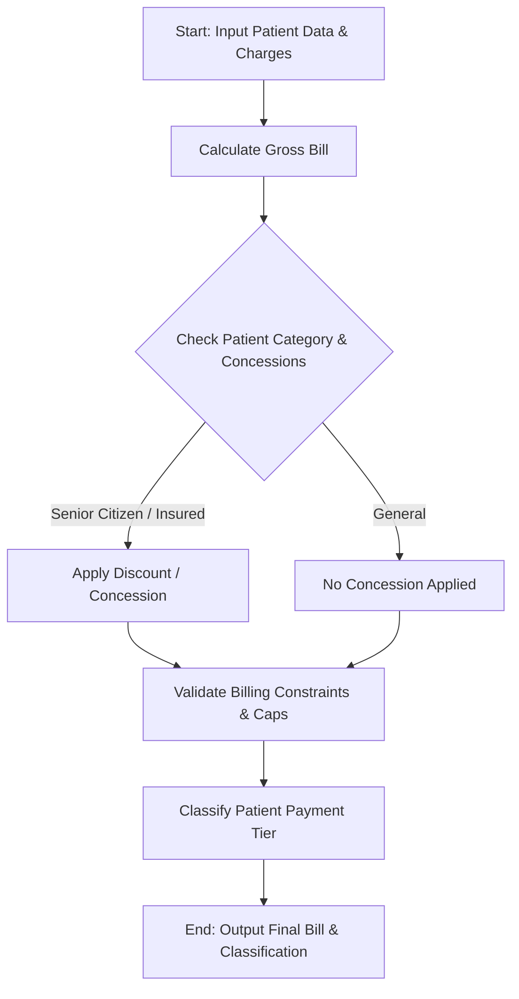

## Problem Statement

Develop an automated hospital billing and patient classification system. The system must process consultation fees, diagnostic charges, and treatment costs for hospital patients, apply conditional concessions or insurance discounts based on patient categories, validate billing constraints (such as maximum out-of-pocket caps or minimum payable amounts), and classify patients into specific payment tiers or discharge statuses according to a defined institutional payment policy.

---

## Algorithm

1. **Input**: Receive patient billing details (consultation fee, diagnostics cost, treatment cost), patient category (e.g., General, Senior Citizen, Insured), concession rules, billing limits, and payment policy thresholds.
2. **Gross Bill Calculation**: Sum consultation, diagnostic, and treatment charges to determine the total gross bill.
3. **Concession & Discount Application**:
* Evaluate the patient category and apply applicable percentage discounts or fixed concessions.
* Ensure the net bill does not violate any lower-bound constraints.


4. **Constraint Validation**: Check if the calculated bill exceeds maximum insurance coverage caps or out-of-pocket limits, adjusting the patient-payable amount accordingly.
5. **Patient Classification**: Categorize the patient into a payment tier (e.g., Subsidized, Insurance Claim, Self-Pay) based on the final payable amount and policy criteria.
6. **Output**: Return the itemized billing summary, applied concessions, final payable amount, and patient classification.

---

## Flowchart



---

## Python Source Code

```python
def process_hospital_bill(patient_record, policy):
    consultation = patient_record['consultation']
    diagnostics = patient_record['diagnostics']
    treatment = patient_record['treatment']
    category = patient_record['category']
    
    gross_bill = consultation + diagnostics + treatment
    
    discount_rate = policy['discounts'].get(category, 0.0)
    discount_amount = gross_bill * discount_rate
    
    subtotal = gross_bill - discount_amount
    
    max_cap = policy.get('max_out_of_pocket', float('inf'))
    payable_amount = min(subtotal, max_cap)
    
    if payable_amount <= policy['tiers']['subsidized_limit']:
        classification = "Subsidized Tier"
    elif payable_amount <= policy['tiers']['standard_limit']:
        classification = "Standard Tier"
    else:
        classification = "Premium Tier"
        
    return {
        "patient_id": patient_record['id'],
        "name": patient_record['name'],
        "gross_bill": round(gross_bill, 2),
        "discount_amount": round(discount_amount, 2),
        "payable_amount": round(payable_amount, 2),
        "classification": classification
    }

if __name__ == "__main__":
    policy = {
        "discounts": {
            "General": 0.0,
            "Senior Citizen": 0.15,
            "Insured": 0.25
        },
        "max_out_of_pocket": 50000.0,
        "tiers": {
            "subsidized_limit": 10000.0,
            "standard_limit": 35000.0
        }
    }
    
    patients = [
        {"id": 101, "name": "Alice", "consultation": 1500, "diagnostics": 4000, "treatment": 8000, "category": "Senior Citizen"},
        {"id": 102, "name": "Bob", "consultation": 2000, "diagnostics": 12000, "treatment": 45000, "category": "Insured"},
        {"id": 103, "name": "Charlie", "consultation": 1000, "diagnostics": 2500, "treatment": 5000, "category": "General"}
    ]
    
    for patient in patients:
        result = process_hospital_bill(patient, policy)
        print(result)

```

---

## Sample Input

```json
{
  "policy": {
    "discounts": {
      "General": 0.0,
      "Senior Citizen": 0.15,
      "Insured": 0.25
    },
    "max_out_of_pocket": 50000.0,
    "tiers": {
      "subsidized_limit": 10000.0,
      "standard_limit": 35000.0
    }
  },
  "patients": [
    {"id": 101, "name": "Alice", "consultation": 1500, "diagnostics": 4000, "treatment": 8000, "category": "Senior Citizen"},
    {"id": 102, "name": "Bob", "consultation": 2000, "diagnostics": 12000, "treatment": 45000, "category": "Insured"},
    {"id": 103, "name": "Charlie", "consultation": 1000, "diagnostics": 2500, "treatment": 5000, "category": "General"}
  ]
}

```

---

## Sample Output

```json
{
  "patient_id": 101,
  "name": "Alice",
  "gross_bill": 13500.0,
  "discount_amount": 2025.0,
  "payable_amount": 11475.0,
  "classification": "Standard Tier"
}
{
  "patient_id": 102,
  "name": "Bob",
  "gross_bill": 59000.0,
  "discount_amount": 14750.0,
  "payable_amount": 44250.0,
  "classification": "Premium Tier"
}
{
  "patient_id": 103,
  "name": "Charlie",
  "gross_bill": 8500.0,
  "discount_amount": 0.0,
  "payable_amount": 8500.0,
  "classification": "Subsidized Tier"
}

```
