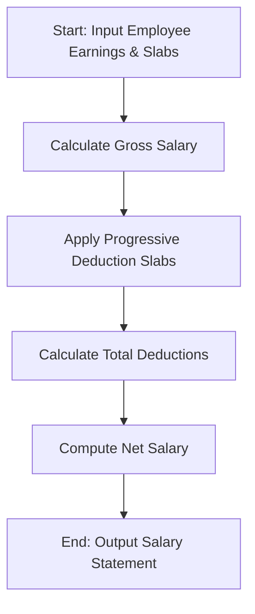

## Problem Statement

Develop an automated employee payroll and deduction analysis system. The system must compute total gross salary by combining basic pay, various allowances, overtime compensation, and performance incentives. Following gross salary determination, it must apply progressive tax and statutory deductions based on predefined salary slabs, validate deduction limits, and generate a comprehensive net salary statement for each employee.

---

## Algorithm

1. **Input**: Receive employee details including basic pay, allowances (housing, transport), overtime hours and rate, performance incentives, and progressive deduction tax slabs.
2. **Gross Salary Calculation**:
* Calculate total allowances by summing housing and transport.
* Calculate overtime pay as overtime hours multiplied by the hourly rate.
* Sum basic pay, total allowances, overtime pay, and incentives to determine the gross salary.


3. **Progressive Deduction Calculation**:
* Evaluate the gross salary against progressive tax and deduction slabs.
* Accumulate total deductions tier by tier.


4. **Net Salary Computation**: Subtract total deductions from the gross salary to determine the final net salary.
5. **Output**: Return the formatted salary statement containing gross earnings, itemized deductions, and net payable salary.

---

## Flowchart



---


---

## Sample Input

```json
{
  "deduction_slabs": [
    [30000, 0.05],
    [50000, 0.12],
    [null, 0.20]
  ],
  "employees": [
    {"id": 201, "name": "David", "basic": 40000, "housing_allowance": 10000, "transport_allowance": 5000, "overtime_hours": 10, "overtime_rate": 200, "incentive": 3000},
    {"id": 202, "name": "Eva", "basic": 25000, "housing_allowance": 6000, "transport_allowance": 3000, "overtime_hours": 5, "overtime_rate": 150, "incentive": 1000},
    {"id": 203, "name": "Frank", "basic": 70000, "housing_allowance": 15000, "transport_allowance": 8000, "overtime_hours": 15, "overtime_rate": 250, "incentive": 5000}
  ]
}

```

---

## Sample Output

```json
{
  "employee_id": 201,
  "name": "David",
  "gross_salary": 60000.0,
  "total_deductions": 5550.0,
  "net_salary": 54450.0
}
{
  "employee_id": 202,
  "name": "Eva",
  "gross_salary": 35750.0,
  "total_deductions": 2190.0,
  "net_salary": 33560.0
}
{
  "employee_id": 203,
  "name": "Frank",
  "gross_salary": 101750.0,
  "total_deductions": 16650.0,
  "net_salary": 85100.0
}

```
