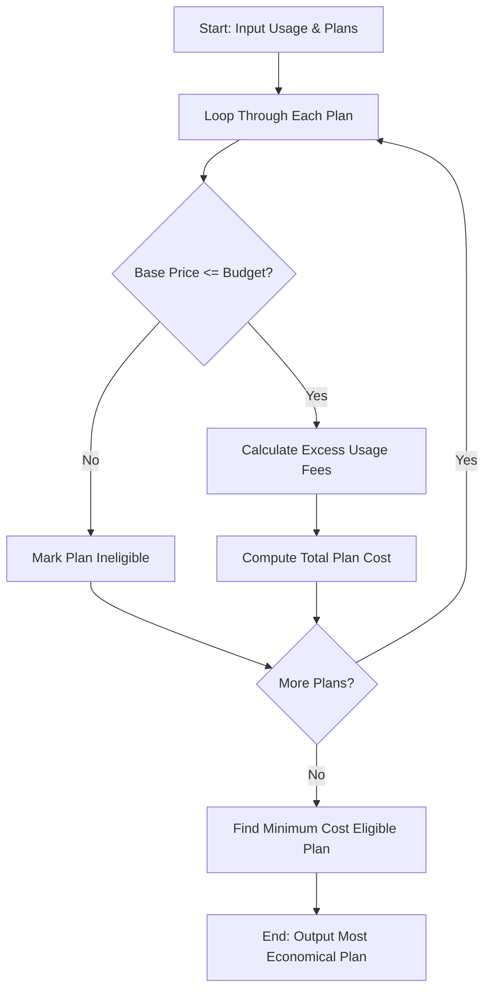

## Problem Statement

Develop a multi-plan telecommunications cost optimization system. Given a user's projected monthly usage (voice minutes, SMS count, data consumption in GB), budget limit, and a catalog of available mobile plans (each with base price, inclusive allowances, validity period, and out-of-quota excess charges), the system must evaluate eligibility against budget and validity constraints, calculate total costs including any excess usage fees, and identify the most economical eligible plan.

---

## Algorithm

1. **Input**: Receive user usage requirements (voice, sms, data), budget constraint, and a list of available mobile plans.
2. **Eligibility Filtering**: Iterate through each plan and check if its base price is within the user's budget.
3. **Cost Calculation for Eligible Plans**:
* Compute excess voice minutes: $\max(0, \text{user\_voice} - \text{plan\_voice})$.
* Compute excess SMS: $\max(0, \text{user\_sms} - \text{plan\_sms})$.
* Compute excess data: $\max(0, \text{user\_data} - \text{plan\_data})$.
* Calculate total excess charges by multiplying excess units by their respective per-unit rates.
* Determine the total monthly cost: $\text{Base Price} + \text{Total Excess Charges}$.


4. **Optimization Selection**: Compare the total costs of all eligible plans and select the one with the minimum total cost.
5. **Output**: Return the cost breakdown for all evaluated plans and the details of the most economical eligible plan.

---

## Flowchart




---

## Sample Input

```json
{
  "usage": {
    "voice": 450,
    "sms": 150,
    "data": 12.0
  },
  "budget": 600.0,
  "plans": [
    {
      "name": "Basic Saver",
      "base_price": 300.0,
      "inclusive_voice": 300,
      "inclusive_sms": 100,
      "inclusive_data": 5.0,
      "rate_voice": 1.5,
      "rate_sms": 0.5,
      "rate_data": 20.0
    },
    {
      "name": "Standard Flex",
      "base_price": 450.0,
      "inclusive_voice": 500,
      "inclusive_sms": 200,
      "inclusive_data": 10.0,
      "rate_voice": 1.0,
      "rate_sms": 0.4,
      "rate_data": 15.0
    },
    {
      "name": "Unlimited Pro",
      "base_price": 700.0,
      "inclusive_voice": 1000,
      "inclusive_sms": 500,
      "inclusive_data": 25.0,
      "rate_voice": 0.5,
      "rate_sms": 0.2,
      "rate_data": 10.0
    }
  ]
}

```

---

## Sample Output

```json
{"plan_name": "Basic Saver", "eligible": true, "base_price": 300.0, "excess_cost": 305.0, "total_cost": 605.0}
{"plan_name": "Standard Flex", "eligible": true, "base_price": 450.0, "excess_cost": 30.0, "total_cost": 480.0}
{"plan_name": "Unlimited Pro", "eligible": false, "reason": "Exceeds budget", "total_cost": null}
Best Plan: {'plan_name': 'Standard Flex', 'eligible': True, 'base_price': 450.0, 'excess_cost': 30.0, 'total_cost': 480.0}

```
