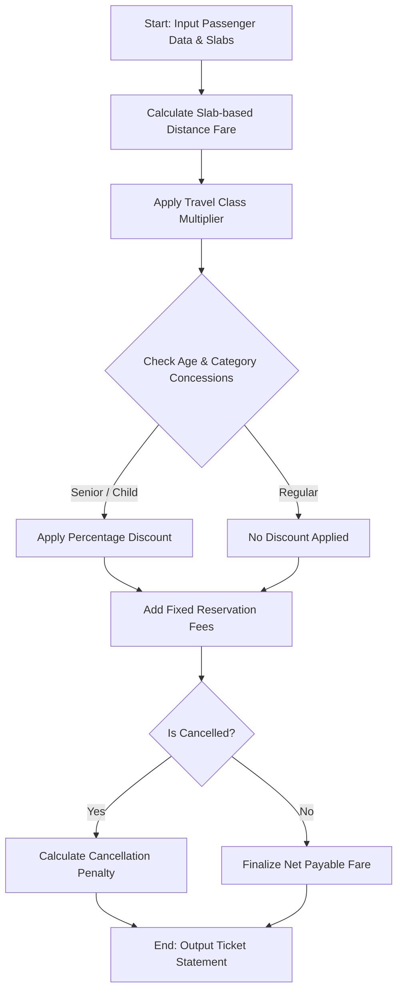

## Problem Statement

Develop an automated railway fare and reservation calculation system. The system must compute base ticket fares using progressive distance slabs and travel class multipliers for multiple passengers. It must apply age-based concessions, add mandatory reservation and dynamic service fees, compute total passenger totals, and calculate applicable cancellation penalties upon request.

---

## Algorithm

1. **Input**: Receive passenger details (name, age, travel class, distance in kilometers, cancellation status), distance fare slabs, class multipliers, concession rules, and fixed reservation charges.
2. **Base Fare Calculation**:
* Compute base fare by traversing distance slabs and multiplying by the appropriate travel class factor.


3. **Concession & Fees Application**:
* Apply age-based concessions (e.g., Senior Citizen, Child).
* Add fixed reservation fees and surcharges.


4. **Cancellation Processing**: If a passenger requests cancellation, calculate the penalty fee based on the fare rules.
5. **Output**: Return itemized passenger fare statements, net payable amounts, and cancellation charges.

---

## Flowchart




---

## Sample Input

```json
{
  "distance_slabs": [
    [100, 1.5],
    [400, 1.2],
    [null, 0.9]
  ],
  "class_multipliers": {
    "Sleeper": 1.0,
    "AC_3Tier": 2.5,
    "AC_1Tier": 4.0
  },
  "fixed_reservation_fee": 50.0,
  "cancellation_fee_rate": 0.20,
  "passengers": [
    {"name": "Alice", "age": 65, "class": "AC_3Tier", "distance": 600, "category": "Senior", "is_cancelled": false},
    {"name": "Bob", "age": 30, "class": "Sleeper", "distance": 250, "category": "Regular", "is_cancelled": true},
    {"name": "Charlie", "age": 10, "class": "AC_1Tier", "distance": 800, "category": "Child", "is_cancelled": false}
  ]
}

```

---

## Sample Output

```json
{
  "passenger_name": "Alice",
  "class": "AC_3Tier",
  "gross_fare": 1650.0,
  "discount": 660.0,
  "reservation_fee": 50.0,
  "total_fare": 1040.0,
  "is_cancelled": false,
  "cancellation_charge": 0.0,
  "net_payable": 1040.0
}
{
  "passenger_name": "Bob",
  "class": "Sleeper",
  "gross_fare": 330.0,
  "discount": 0.0,
  "reservation_fee": 50.0,
  "total_fare": 380.0,
  "is_cancelled": true,
  "cancellation_charge": 76.0,
  "net_payable": 76.0
}
{
  "passenger_name": "Charlie",
  "class": "AC_1Tier",
  "gross_fare": 4080.0,
  "discount": 2040.0,
  "reservation_fee": 50.0,
  "total_fare": 2090.0,
  "is_cancelled": false,
  "cancellation_charge": 0.0,
  "net_payable": 2090.0
}

```
