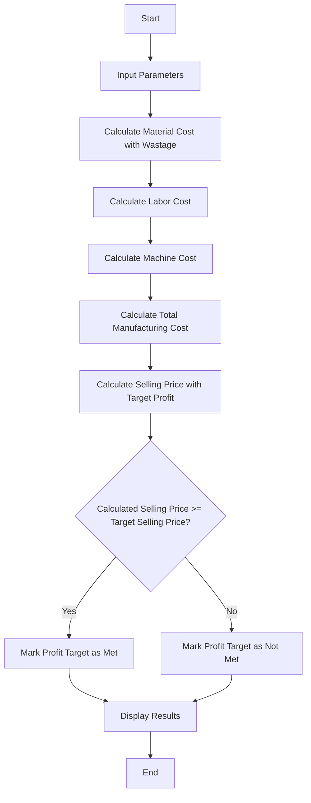

## Problem Statement

Develop a program to calculate the total manufacturing cost of a product—incorporating raw material costs, labor charges, wastage, machine operating costs, and overheads—and determine whether the production meets a specified profit target and target selling price.

---

## Algorithm

1. **Start**
2. **Input** raw material cost, labor hours, labor rate per hour, machine hours, machine rate per hour, wastage percentage, overhead costs per unit, target profit percentage, and target selling price.
3. **Calculate** material cost including wastage:

$$\text{Material Cost with Wastage} = \text{Material Cost} \times \left(1 + \frac{\text{Wastage \%}}{100}\right)$$


4. **Calculate** labor cost:

$$\text{Labor Cost} = \text{Labor Hours} \times \text{Labor Rate}$$


5. **Calculate** machine cost:

$$\text{Machine Cost} = \text{Machine Hours} \times \text{Machine Rate}$$


6. **Calculate** total manufacturing cost:

$$\text{Total Cost} = \text{Material Cost with Wastage} + \text{Labor Cost} + \text{Machine Cost} + \text{Overheads}$$


7. **Calculate** selling price based on the target profit margin:

$$\text{Calculated Selling Price} = \text{Total Cost} \times \left(1 + \frac{\text{Target Profit \%}}{100}\right)$$


8. **Evaluate** if the calculated selling price meets or exceeds the target selling price or profit goal.
9. **Display** total manufacturing cost, calculated selling price, and profitability status.
10. **End**

---

## Flowchart



---


---

## Sample Input

* **Material Cost:** $120.00
* **Labor Hours:** 2.5 hours
* **Labor Rate:** $18.00 / hour
* **Machine Hours:** 1.5 hours
* **Machine Rate:** $30.00 / hour
* **Wastage Percentage:** 5%
* **Overheads:** $25.00
* **Target Profit Percentage:** 20%
* **Target Selling Price:** $260.00

---

## Sample Output

```text
Total Manufacturing Cost: $211.00
Calculated Selling Price: $253.20
Profit Target Met: False

```
