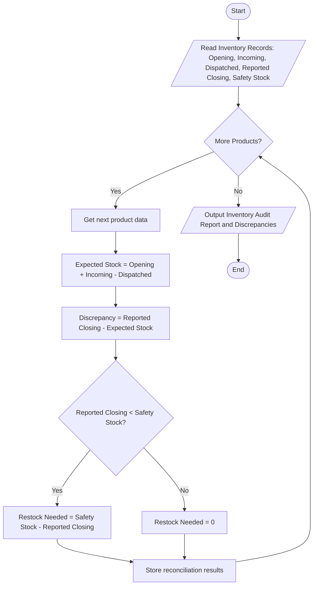

## Problem Statement

Develop a warehouse inventory reconciliation program that compares opening stock, incoming shipments, dispatched quantities, and reported closing stock across multiple products. The program must detect discrepancies, compute actual physical stock levels, identify shortages or surpluses, and calculate replenishment requirements based on minimum safety stock levels.

---

## Algorithm

1. **Initialize Inputs:** Read inventory records containing product names, opening stock, incoming quantities, dispatched quantities, reported closing stock, and minimum safety stock requirements for each product.
2. **Iterate Through Products:** For each product:
* Calculate the expected closing stock using the formula:

$$\text{Expected Closing Stock} = \text{Opening Stock} + \text{Incoming Quantities} - \text{Dispatched Quantities}$$


* Compare the expected closing stock with the reported closing stock to detect any discrepancy (shortage or surplus).
* Determine the replenishment requirement: if the reported/actual closing stock is below the minimum safety stock, calculate the exact quantity needed to restore stock to the safe threshold level.


3. **Record Findings:** Store discrepancy status, variance values, and replenishment needs for each product.
4. **Output Results:** Display a comprehensive inventory audit report detailing expected vs. actual stock, variances, and restocking requirements.

---

## Flowchart



---


---

## Sample Input

* **Warehouse Stock Data:**
```python
{
    "Laptop": {
        "opening": 120,
        "incoming": 50,
        "dispatched": 80,
        "reported_closing": 88,
        "safety_stock": 50,
    },
    "Monitor": {
        "opening": 200,
        "incoming": 30,
        "dispatched": 110,
        "reported_closing": 115,
        "safety_stock": 100,
    },
    "Keyboard": {
        "opening": 350,
        "incoming": 100,
        "dispatched": 250,
        "reported_closing": 190,
        "safety_stock": 200,
    },
}

```


---

## Sample Output

```text
Warehouse Inventory Audit Report:
Product: Laptop
  Expected Closing Stock: 90
  Reported Closing Stock: 88
  Stock Discrepancy: -2
  Replenishment Required: 0
----------------------------------------
Product: Monitor
  Expected Closing Stock: 120
  Reported Closing Stock: 115
  Stock Discrepancy: -5
  Replenishment Required: 0
----------------------------------------
Product: Keyboard
  Expected Closing Stock: 200
  Reported Closing Stock: 190
  Stock Discrepancy: -10
  Replenishment Required: 10
----------------------------------------

```
