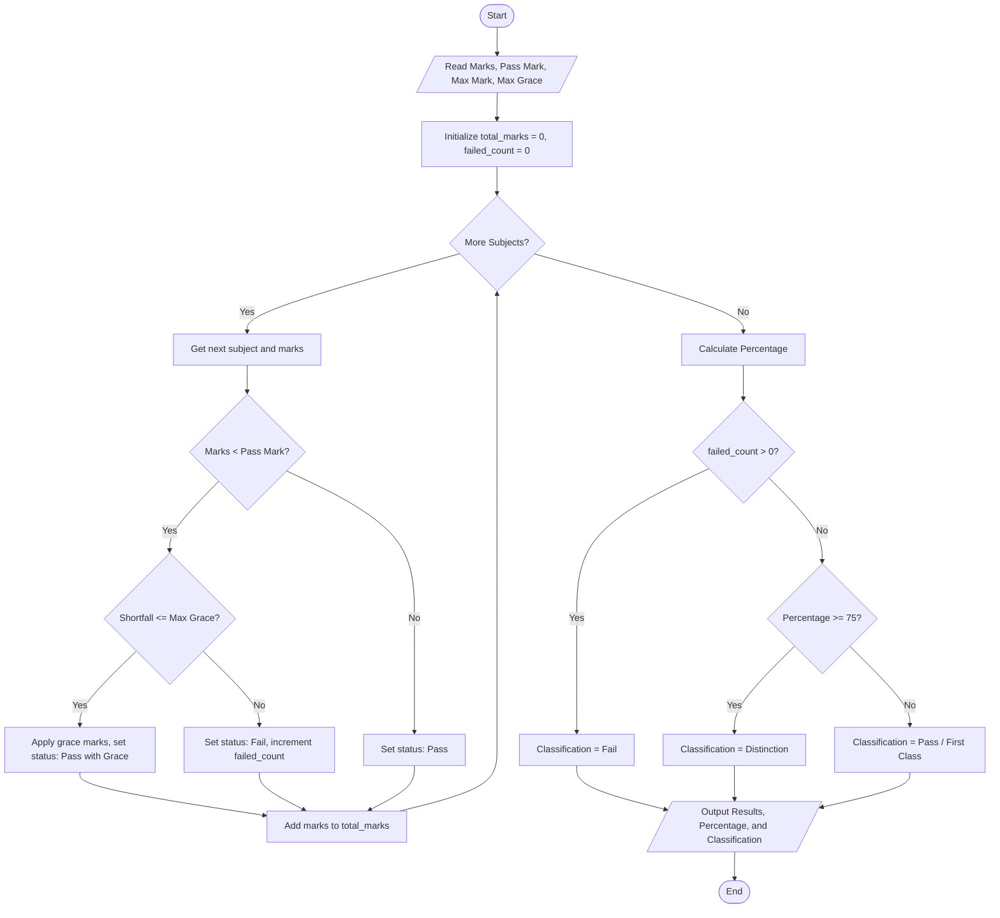

## Problem Statement

Develop an examination result and grace-mark validation system that processes student marks across multiple subjects. The program must evaluate subject-wise passing criteria, apply a specified grace-mark policy for marginal failures without exceeding the maximum mark limit, and generate final classifications (such as Pass, Distinction, or Fail) along with aggregate percentages.

---

## Algorithm

1. **Initialize Inputs:** Read subject names, marks obtained in each subject, maximum marks per subject, passing threshold per subject, and maximum allowable grace marks per subject.
2. **Iterate Through Subjects:** For each subject:
* Validate that the obtained mark is within the valid range ($0$ to maximum marks).
* Check if the marks are below the passing threshold.
* If below the threshold, calculate the shortfall. If the shortfall is less than or equal to the maximum allowable grace marks, apply grace marks to meet the passing threshold.
* Update individual subject statuses (Pass, Pass with Grace, or Fail) and accumulate total valid marks.


3. **Count Failures:** Track the total number of subjects failed after applying the grace-mark policy.
4. **Calculate Percentage:** Compute the aggregate percentage based on total obtained marks and maximum possible marks.
5. **Determine Classification:**
* If there are any failed subjects, assign a **Fail** classification.
* If all subjects are passed, assign a classification based on the aggregate percentage (e.g., Distinction for $\ge 75\%$, First Class for $\ge 60\%$, or Pass).


6. **Output Results:** Display subject-wise breakdown, total marks, percentage, and final classification.

---

## Flowchart



---


---

## Sample Input

* **Subject Marks:** `{'Mathematics': 38, 'Physics': 72, 'Chemistry': 65, 'Computer Science': 85, 'English': 78}`
* **Passing Mark Threshold:** `40`
* **Maximum Marks per Subject:** `100`
* **Maximum Allowable Grace Marks:** `5`

---

## Sample Output

```text
Subject-wise Results:
  Mathematics: 40 - Pass (Grace)
  Physics: 72 - Pass
  Chemistry: 65 - Pass
  Computer Science: 85 - Pass
  English: 78 - Pass

Total Marks: 340 / 500
Percentage: 68.00%
Final Classification: First Class

```
