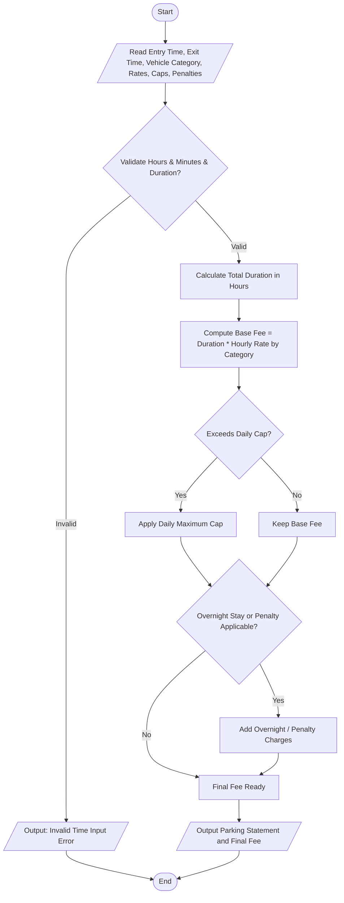

## Problem Statement

Develop a smart parking fee management system that calculates parking charges based on vehicle entry and exit timestamps, vehicle categories (such as Two-Wheeler, Car, or SUV), duration of stay, overnight parking rules, daily maximum caps, and penalty conditions for overdue or unauthorized parking while thoroughly validating all time inputs.

---

## Algorithm

1. **Initialize Inputs:** Read vehicle category, entry time (in hours and minutes), exit time (in hours and minutes), day type (weekday/weekend), daily maximum cap, overnight status flag, and penalty status.
2. **Validate Time Inputs:** Check that hour values are between $0$ and $23$, minute values are between $0$ and $59$, and that the exit time is chronologically valid relative to entry time.
3. **Calculate Duration:** Compute total parking duration in hours (accounting for multi-day stays or cross-midnight calculation if applicable).
4. **Determine Base Charges:** Apply category-specific hourly rates for the duration of stay.
5. **Apply Overtime / Daily Caps:** Check if the calculated fee exceeds the daily maximum cap or if additional overnight charges apply; adjust fees accordingly.
6. **Check Penalties:** If penalty conditions are met (e.g., lost ticket or unauthorized zone), add the penalty amount to the final fee.
7. **Output Results:** Display duration, base charges, applied caps/penalties, and the final parking fee.

---

## Flowchart



---


---

## Sample Input

* **Entry Time:** `10:30`
* **Exit Time:** `18:00`
* **Vehicle Category:** `Car`
* **Hourly Rate:** `40.0`
* **Daily Maximum Cap:** `300.0`
* **Overnight Status:** `False`
* **Penalty Status:** `False`

---

## Sample Output

```text
Vehicle Category: Car
Parking Duration: 7.50 hours
Base Fee: 300.0
Overnight Charge: 0.0
Penalty Charge: 0.0
Total Parking Fee: 300.0

```
